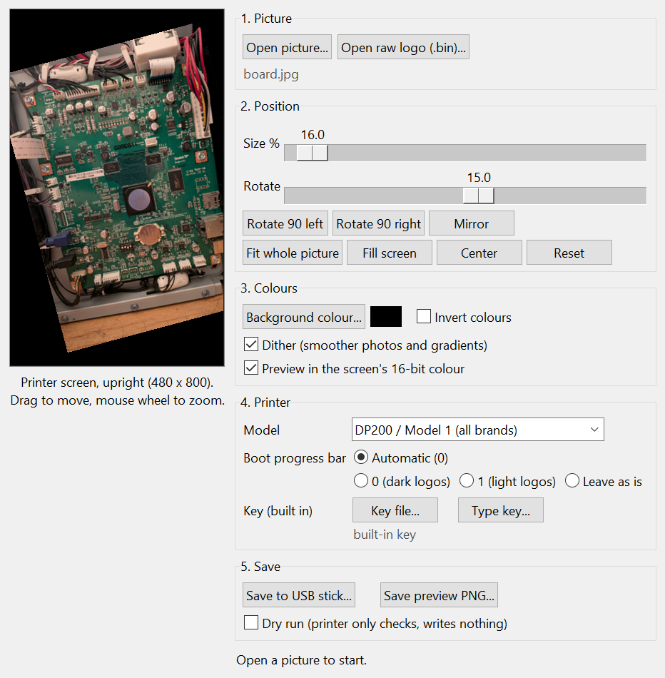

# Custom boot logo

Turn any picture into the printer's boot logo. The tool packs it into an
encrypted `.she` update file, which the printer's own USB update
(`/app/auto_update.sh`) installs. You don't need a serial console, a root
shell or Klipper. It works on stock firmware and on Klipper-ported printers.

There are two versions, which share `bootlogo_core.py`:
- **`SindohBootLogo.exe`** / `sindoh_bootlogo_gui.py`: a Windows program
  with a live preview of the printer screen;
- **`sindoh_bootlogo.py`**: a command-line version for Windows, Linux and
  macOS.

Both do the encryption themselves; no `openssl` is needed.

## What the boot logo is (DP200, verified)

The DP200 family is the Sindoh 3DWOX DP200 and its rebrands (Stanley,
Leon3D, Mimaki Model 1). They share the boot logo format and the update key;
the key is built into the tool and was checked on a Sindoh DP200 and on a
Stanley Model 1.

- **Where:** the flash partition `boot-logo` (`mtd3`, 1 MiB). U-Boot reads it
  at power-on.
- **Format:** one raw frame-buffer image, **800 × 480 pixels, RGB565
  little-endian, no header** (768000 bytes). The panel is mounted in
  portrait, so the image is stored turned 90°. Draw your logo **upright at
  480 × 800**; the tool turns it.
- **Progress bar:** U-Boot draws a progress bar over the logo. Its colour is
  the U-Boot variable `bar_color`: Sindoh uses 0 for dark logos (Sindoh,
  Leon3D) and 1 for light ones (Stanley, Mimaki).
- **The stock logos** are in `/app/boot-logo_{sindoh,stanley,leon3d,mimaki}.bin`.
  The OEM update (`image.logo`) carries `boot-logo_rodin.bin`, which is the
  same file as the Sindoh one.
- **When it gets replaced:** an OEM firmware update (`update.she`) writes
  the brand's stock logo back, chosen by the printer's TLI. So does the
  factory `--set-tli` step. After an OEM update, run your logo stick again.

## The window version



1. Start `SindohBootLogo.exe`, or `python sindoh_bootlogo_gui.py` with
   Python 3.8+ and `pip install pillow`. Then:
   - **Open picture...** (PNG, JPG, BMP, GIF, WebP, TIFF);
   - drag the picture to move it, use the mouse wheel to zoom, or use the
     Size / Rotate sliders, *Rotate 90*, *Mirror*, *Fit whole picture*,
     *Fill screen*, *Center*;
   - pick a background colour, *Invert colours*, and *Dither* (on for
     photos and gradients, off for flat-colour logos). The preview shows
     the screen's real 16-bit colour;
   - choose the printer model and the boot progress bar colour: Automatic,
     0 (dark logos), 1 (light logos) or *Leave as is*;
   - the update key is built in. If your printer uses another one,
     **Key file...** loads the `crypto_key.dat` from your printer's `/app`, or
     **Type key...** takes it as text.
2. **Save to USB stick...**: choose the stick, or any folder whose
   `_update_rodin` folder you'll copy onto a FAT32 stick later. The file is
   checked by decrypting it again before it's saved.
3. Plug the stick into the printer. It shows "Touch to install the new boot
   logo"; touch the screen. The new logo appears at the next power-on.

**Open raw logo (.bin)...** loads a raw logo exactly, for example the
`bootlogo_original.bin` the stick saved. Saving it unchanged puts the old
logo back bit for bit.

To build the `.exe` yourself: `pip install pillow pyinstaller`, then run
`build_exe.bat` (it writes to `dist\`).

## The command-line version

```
python sindoh_bootlogo.py my_logo.png
```
This writes `bootlogo_usb/_update_rodin/unmistakable_bootlogo.she` and
`bootlogo_usb/bootlogo_preview.png` (what the screen will show). Copy the
`_update_rodin` folder to the root of a FAT32 USB stick.

The first time, the stick also gets **`bootlogo_original.bin`**, the logo
that was on the printer. To put it back:
```
python sindoh_bootlogo.py bootlogo_original.bin
```
(A `.bin` input is packed as it is.)

| Option | |
|---|---|
| `--fit contain` | whole picture, with `--bg` colour bars around it (default) |
| `--fit cover` | fill the screen, crop the edges |
| `--fit stretch` | distort to 480 × 800 |
| `--bg COLOUR` | background for `contain` and transparent areas (default black) |
| `--invert` | invert the picture's colours |
| `--no-dither` | plain rounding to 16-bit colour, best for flat-colour logos. The default dithers, best for photos and gradients. |
| `--bar-color auto/0/1/keep` | progress bar colour; `auto` uses 0 for dark pictures and 1 for light ones |
| `--dry-run` | the stick only runs the checks and writes nothing |
| `--decode logo.bin out.png` | view a raw logo (a backup, a stock logo) upright |
| `--out DIR` | output folder (default `bootlogo_usb`) |
| `--key-file crypto_key.dat` / `--key TEXT` | use another update key instead of the built-in one |

**Rehearsal (both versions):** with *Dry run* or `--dry-run`, the stick gets
an empty `dry_run` file. The printer then runs every check (partition, size,
md5, current logo) and writes nothing. Delete that file, or save again
without the option, to install for real.

## What runs on the printer

`unmistakable_bootlogo.sh` is packed inside the `.she` next to the image. It:
1. finds the partition by its name `boot-logo` in `/proc/mtd`, not by
   number;
2. refuses to write if the image is bigger than the partition, or if its
   size or md5 doesn't match;
3. returns without writing if the logo is already installed;
4. saves the current logo to the stick once (`bootlogo_original.bin`);
5. asks for a touch, then erases the partition, writes it (`nandwrite -p`)
   and reads it back to compare;
6. sets `bar_color`.

A failed write leaves the printer booting normally (the logo is only a
picture). Run the stick again, or restore `bootlogo_original.bin`.

Tested 2026-10-27 on a DP200:
- the stock logos are reproduced exactly (PNG → `.bin` round trip, md5 equal);
- the Python Triple DES / AES match `openssl` byte for byte;
- the printer's OpenSSL 1.0 decrypts the `.she`, and the script passes every
  check in `dry_run` mode;
- a test logo was flashed and read back (`mtd3` md5 equals the image).

## Newer 3DWOX 1 models (not verified)

These printers use AES-256-CBC `.she` files and a `_update_rodin_up` folder
(see the main README). `--model 3dwox1 --experimental` packs that way, but
their logo partition and panel size are unknown. Until someone checks them,
the tool refuses this model without `--experimental`. What would settle it:
- a 3DWOX 1 OEM update (its `image.logo`, or `/app/boot-logo_*.bin`
  from the printer);
- or the output of `cat /proc/mtd` and `cat /sys/class/graphics/fb0/virtual_size`
  from one.

If its logo is the same 768000-byte format, only the cipher differs. Even
then, the on-printer script checks the partition name and size before
writing.
