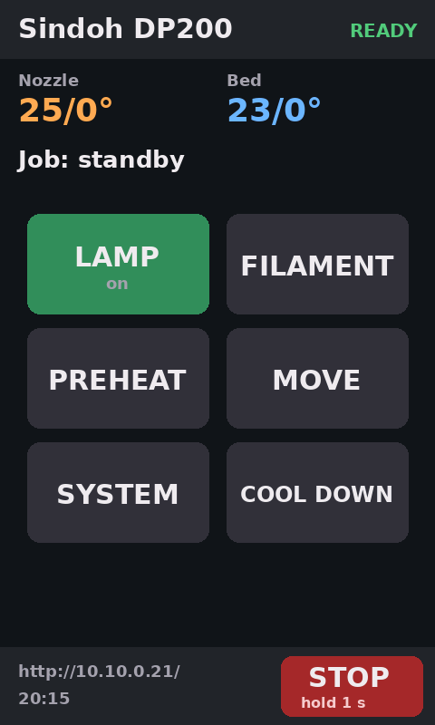
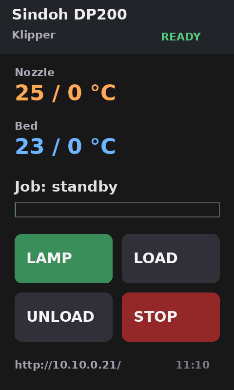

# DP200 built-in touch panel: options

**Update 2026-10-20 (later):** option A is implemented as
`install/display/dp200_screen.py` and runs as the `screen` service of
`rc.dp200`; `SCREEN_ENABLED=0` in `/etc/dp200/screen.conf` turns it off.

What it does:
- Screens: home, printing (shown automatically during a print), filament,
  preheat, move/maintenance, system, and an error page when Klipper is
  shut down.
- Confirmation dialogs before anything that moves or heats.
- STOP needs a 1 s hold.
- After 10 min idle the image is blanked, and the first tap only wakes it.
  The backlight stays on: it isn't controllable from the framebuffer
  (fb0 `blank` only blanks the image, user-tested), which the user said is
  fine.

Measurements:
- About 22 MB RSS and about 1 % of one core when idle. It redraws only when
  a displayed value changes, and writes only the changed region.
- `test_dp200_screen.py` checks the button logic with simulated taps and
  stubbed Moonraker calls (14/14 pass). The real panel has only been tested
  with the touch-calibration taps, so the first real button presses should
  happen with the user present.



Status 2026-10-20: investigated, proof of concept drawing on the panel.
Nothing is installed to start automatically yet.

## The hardware (measured on the printer)

| | |
|---|---|
| Display | `/dev/fb0`, driver `mv61x0`, 800×480 @ 60 Hz, 16 bpp RGB565 little-endian, stride 1600 |
| Mounting | **Portrait, 480×800 as seen by the user.** Draw 480×800 and `transpose(ROTATE_270)` (90° clockwise) before writing to fb0: portrait (u, v) = fb (x = 799 − v, y = u). Confirmed upright by the user 10-20. |
| Pages | virtual 800×960 (two pages, panned to 0,0). The PoC writes both pages so either one shows the image. |
| Touch | Rohm BU21029GUL (resistive touch controller, I²C), `/dev/event0` |
| Touch events | EV_SYN + EV_ABS only (`EV=9`): ABS_MT_POSITION_X/Y, ABS_MT_TRACKING_ID, ABS_MT_TOUCH_MAJOR. No BTN_TOUCH, no single-touch ABS_X/ABS_Y. |
| CPU | dual-core PJ4B-MP (ARMv7), but the Debian userland is **armel** (soft-float ARMv5 ABI; the vendor kernel 3.2 has no Thumb support, so armhf can't run) |
| Free RAM with Klipper, Moonraker, webcam and nginx running | ~135 MB free + ~240 MB page cache (494 MB total, no swap) |

The stock UI (UIManager + appBrowser, ~98 MB) is already stopped by
`dp200-start.sh`, so the panel is free for us.

### Touch (4-corner test 10-20, `install/display/touch_cal.py`)

Events are the kernel 3.2 time32 `input_event` (16 bytes, `<llHHi`: sec,
usec, type, code, value), not Debian trixie's 24-byte time64 struct, so
read `/dev/event0` raw instead of using python-evdev. The panel uses
protocol A (no ABS_MT_SLOT): each SYN_REPORT carries X/Y while pressed,
and an empty frame (or ~0.3 s of silence) means the finger was lifted.
EVIOCGABS: MT_X 190..3930, MT_Y 390..3710.

| Target (portrait px) | raw x | raw y |
|---|---|---|
| 1 top-left (50, 50) | 3624 | 783 |
| 2 top-right (430, 50) | 3617 | 3457 |
| 3 bottom-right (430, 750) | 474 | 3407 |
| 4 bottom-left (50, 750) | 480 | 829 |

Axes are swapped, and raw x is inverted. Linear fit (clamp to the screen):

    u (portrait x, 0..479) = 0.14471 * raw_y - 66.6
    v (portrait y, 0..799) = 856.2 - 0.22272 * raw_x

The corners agree to about ±4 px, so no skew term is needed. Noise per tap:
roughly ±40 raw counts, which is ±6–9 px; use the median of a tap's samples.

Not checked yet: backlight on/off or dimming (to blank the screen when idle).
It's probably an `io:pwm` or GPIO used by the stock UI; not found yet.

## Why KlipperScreen is a poor fit

KlipperScreen is a Python GTK3 app that needs an X server
(Xorg + fbdev driver here, since there's no DRM/KMS on kernel 3.2).

- **Resources.** Xorg + GTK3 + PyGObject + KlipperScreen typically uses
  100–150 MB RSS. That leaves no margin next to klippy (37 MB), Moonraker
  (21 MB) and the webcam on a 494 MB machine without swap. GTK3 drawing is
  also software-only, on an ARMv5 soft-float userland: menus would redraw
  in seconds, not milliseconds.
- **Input.** The touch controller sends multitouch-ABS-only events.
  `xf86-input-evdev`/libinput need udev (absent: no systemd, static /dev in
  a chroot) and the time64/time32 `input_event` mismatch would need a shim
  like the camera one.
- **Size.** It would also add ~150–200 MB of packages to a NAND install
  that has ~190 MB in total for everything (see `internal_firmware_plan.md`).

It could run eventually, but it would use the most effort and the most
risk, for the least gain.

## Options

| Option | Effort | RAM | Notes |
|---|---|---|---|
| **A. Custom Python framebuffer UI** (Pillow → `/dev/fb0`, raw `/dev/event0` read, Moonraker HTTP/websocket) | low–medium | ~20 MB | **Recommended.** PoC already runs (below). No new packages except `python3-pil` (installed) and `fonts-dejavu-core` (installed). Full control over what's shown. |
| B. GuppyScreen (LVGL, C, made for Creality K1 / Flashforge) | medium–high | ~10–15 MB | Native framebuffer + evdev, fast. Release binaries are MIPS/armhf, so it needs a rebuild for armel (ARM mode). Its layouts are landscape; a 480×800 portrait layout (or LVGL display rotation) would be needed. Its evdev driver needs patches for the time32 input_event and single-point touch. Also a good choice, if we want a full-featured UI later. |
| C. KlipperScreen | high | 100–150 MB | See above. |
| D. Stock appBrowser (Qt WebKit) pointed at a small local web page | medium | ~98 MB | Old WebKit/JS. Uses the same memory we freed for Klipper. |
| E. Static status only (no touch) | very low | ~15 MB | Option A without the input part, i.e. today's PoC. |

## Proof of concept (option A)

`install/display/fb_status_poc.py`, run as root in the chroot with
Debian's `python3-pil` (the moonraker-env Pillow lacks FreeType):

```
chroot /mnt/sd /usr/bin/python3 /usr/src/dp200/display/fb_status_poc.py --loop
```



(Grabbed from `/dev/fb0` with `tools/fb_grab.py`.)

Timing per full-screen refresh on the printer:

| Step | Time |
|---|---|
| Moonraker query | 0.07–0.3 s |
| Pillow drawing (text, boxes) | 0.10–0.14 s |
| RGB565 conversion (LUTs + ImageChops) | 0.27 s |
| fb write | < 0.01 s |

Before the conversion fix, a Python per-pixel loop took 5 s per refresh,
because Pillow 11 has no `BGR;16` packer. At one refresh every 2 s the cost
is ~20 % of one core. A real UI should redraw only changed regions
(temperatures, progress, clock), and convert only those regions. That
should bring it down to a few %. A 1 Hz refresh while printing and
5–10 s when idle is plenty.

## Proposed screens and controls

Design rules: big targets (≥ 120×80 px, resistive touch), no free text
entry, and a confirmation step for anything that moves, heats or cancels.
Everything goes through Moonraker's `/printer/gcode/script`, using the
macros that already exist, so the panel and Mainsail always agree.

**1. Home / idle (default)**
- Shows the state (ready / printing / error), nozzle and bed temperatures
  (actual/target), the Mainsail URL plus a QR code for it, and the clock.
- Buttons:
  - LAMP: toggles `LAMP_TOGGLE`; lit when on.
  - FILAMENT: opens screen 3.
  - PREHEAT: PLA 200/60, PETG 235/80, or OFF (confirm).
  - MOVE: opens screen 4.
  - More: opens screen 5.

**2. Printing (shown automatically while a print runs)**
- File name, a progress bar with % and time left (`display_status`,
  `print_stats`), temperatures, current layer, and a small Z offset
  readout.
- Buttons:
  - PAUSE / RESUME.
  - CANCEL (confirm).
  - LAMP.
  - Z −0.025 / +0.025 (`SET_GCODE_OFFSET Z_ADJUST=… MOVE=1`), for
    first-layer babystepping.
  - Speed and flow ± (optional).

**3. Filament**
- LOAD and UNLOAD (both heat up and run the existing macros; confirm, and
  show the temperature while heating).
- Cartridge lever and filament encoder status (from the sensors in
  `dp200_macros.cfg`).

**4. Move / maintenance** (every action asks for confirmation)
- HOME ALL.
- LOWER BED (Z+100, to reach the purge bin).
- CLEAN NOZZLE.
- Motors off.

**5. More / system**
- Shows the IP and WiFi network, the Klipper/Moonraker state, and the error
  message when Klipper is in shutdown.
- Buttons:
  - FIRMWARE_RESTART.
  - RESTART HOST SERVICES.
  - Screen off (if the backlight can be controlled).
  - SHUT DOWN (stops the stack safely before power-off).

**Always visible:** a STOP button (emergency stop, `M112` through
`/printer/emergency_stop`) at the edge of the screen, with a press-and-hold
of 1 s instead of a confirmation dialog so it stays fast.

**Error overlay:** when `webhooks.state` is `shutdown`/`error`, a full-width
red banner shows the message plus a FIRMWARE_RESTART button.

## Suggested next steps

1. With someone at the printer: find the backlight control. (Orientation
   and touch calibration were done 10-20.)
2. Turn the PoC into `dp200-screen.py`:
   - a Moonraker websocket subscription (no polling);
   - dirty-rectangle redraws;
   - a touch reader thread;
   - the screens above.
3. Start it from `rc.dp200` like the other services (`restart-screen`,
   `SCREEN_ENABLED` in a config file).
4. Add it to the USB installer and to the NAND size budget (it needs only
   `python3-pil` + DejaVu fonts: ~10 MB).
